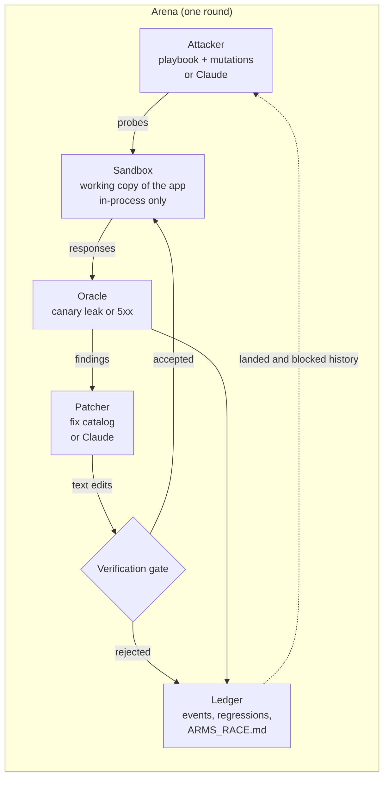

# codebase-red-team

[](https://github.com/AkshayTallikar/codebase-red-team/actions/workflows/ci.yml)

An attacker agent breaks a deliberately vulnerable web app. A patcher agent fixes it. Every fix has to survive the attacker's next round, which mutates exactly the payloads that were just blocked. The history of that arms race is the output.

```
$ python -m redteam run
round 1: 9 probes, 4 findings, 4 patches accepted, 0 rejected
round 2: 22 probes, 2 findings, 2 patches accepted, 0 rejected
round 3: 28 probes, 0 findings, 0 patches accepted, 0 rejected
result: hardened, 0 open after 3 rounds (stopped: clean_round)
```

## Why

Security review is usually one shot: a scanner runs, someone patches the findings, and nobody checks whether the patch closed the hole or just moved it. Real attackers adapt. Strip `../` from a filename and the next request sends `....//`. Block the word `OR` and the next request sends `or`.

This project treats hardening as an adversarial loop instead:

- the attacker learns from what got blocked, not just from what worked
- a patch is only accepted if it kills the exploit, keeps every earlier exploit dead, and leaves normal use working
- every exploit that ever landed becomes a permanent regression test

## What a run looks like

The bundled target is a small FastAPI notes service with four seeded weaknesses. In the [recorded demo run](examples/demo-run/ARMS_RACE.md):

| Weakness | Round 1 | Round 2 | Round 3 |
|---|---|---|---|
| SQL injection in search | `' OR 1=1 --` leaks the admin's note. Patched by blocking `" OR "` | `' or 1=1 --` walks around the blocklist. Patched with a parameterised query | nothing lands |
| Path traversal in file reads | `../secrets.txt` leaks. Patched by stripping `../` | `....//secrets.txt` survives the stripping. Patched with resolved-path containment | nothing lands |
| Missing ownership check | `GET /notes/1` reads the admin's note. Patched with an owner check | `/notes/6` and `/notes/01`, both blocked | 6 more ids, all blocked |
| Unvalidated `limit` | `limit=0` divides by zero. Patched with bounded int validation | 9 malformed values, all rejected with a 422 | no variants left to try |

The two naive first fixes are intentional: the offline patcher ships the kind of rushed fix teams really merge, so the loop has to catch the bypass and land the real fix. Each run writes:

| File | What it holds |
|---|---|
| [`ARMS_RACE.md`](examples/demo-run/ARMS_RACE.md) | scoreboard and round-by-round story |
| [`events.jsonl`](examples/demo-run/events.jsonl) | every probe, finding, bypass and patch decision |
| [`regressions.json`](examples/demo-run/regressions.json) | every probe that ever landed, by weakness |
| [`final_app.py`](examples/demo-run/final_app.py) | the hardened source |
| [`summary.json`](examples/demo-run/summary.json) | stop reason, patch counts, open weaknesses |

## How it works



1. **Attacker** plans a batch of probes from the app's route list and the attack history. The offline `PlaybookAttacker` starts with one hypothesis per weakness class, then mutates every exploit that landed and every mutation that was blocked (keyword case, quote styles, nested traversal, encoded separators, boundary integers, neighbouring ids). The `LLMAttacker` asks Claude for probes as schema-checked JSON.
2. **Sandbox** loads a per-run working copy of the target behind a test client and sends each probe.
3. **Oracle** has two rules. A response that contains the run's random canary is a leak; any 5xx is a crash. That one leak rule covers SQL injection, broken access control and path traversal.
4. **Patcher** proposes exact `{old, new}` text edits for each finding. The offline `ReferencePatcher` replays a fix catalog; the `LLMPatcher` asks Claude and only ever sees redacted evidence.
5. **Verification gate** applies the edits to a fresh copy and accepts them only if all of these hold:
   - the patched app loads
   - the exploit no longer lands
   - every earlier regression for a closed weakness stays blocked
   - alice can still list, search, read and create her notes and read the public readme

   Deleting the endpoint fails the last check, so it is not a fix.
6. **Arena** repeats until a round finds nothing, the attacker runs out of ideas, or the round limit is hit. A weakness that lands again after an accepted patch is logged as a bypass and reopened.

More detail is in [docs/design.md](docs/design.md).

## Safety boundary

The attacker only ever attacks the bundled sample app, and only inside the Python process:

- The sandbox serves the target through an in-process test client. No sockets are opened and nothing is sent over a network.
- A probe can only be a method, a path starting with `/`, query params, headers and a JSON body. Absolute URLs, `//host` paths and `Host` headers are rejected before anything is sent.
- The only secret in play is a random canary generated per run, and it is redacted from every log and report.
- The seed source is never edited. Patches go to a per-run copy.

`target/vulnerable_app.py` is vulnerable on purpose. Don't deploy it.

## Run it

Requires Python 3.11 or newer.

```bash
git clone https://github.com/AkshayTallikar/codebase-red-team
cd codebase-red-team
python -m venv .venv && source .venv/bin/activate
pip install -e ".[dev]"

python -m redteam run --out runs/demo   # offline, deterministic, no API key
pytest                                  # 96 tests
```

To put Claude on both sides of the fight:

```bash
pip install -e ".[anthropic]"
export ANTHROPIC_API_KEY=...
python -m redteam run --backend anthropic --out runs/claude
python -m redteam run --backend anthropic --model claude-sonnet-5-5   # a larger model
```

With `--backend anthropic` the attacker and patcher call the model with structured outputs, so every response is JSON that matches the agent's schema before it is validated again. If the model declines a request, the attacker falls back to the offline playbook. Options: `--rounds` (default 6) and `--budget` (probes per round, default 40).

## Project layout

```
src/redteam/
  target/vulnerable_app.py   the deliberately vulnerable notes service
  sandbox.py                 in-process loader and the path-only probe boundary
  oracle.py                  canary leak and crash detection, evidence redaction
  agents/attacker.py         PlaybookAttacker, mutation engine, LLMAttacker
  agents/patcher.py          ReferencePatcher fix catalog, LLMPatcher
  patching.py                exact-match text edits
  gate.py                    verification gate and functional checks
  arena.py                   the round loop and the ARMS_RACE.md report
  ledger.py                  append-only event log
  llm/                       LLMBackend protocol, Claude backend, offline fake
  cli.py                     redteam run
examples/demo-run/           a recorded offline run
tests/                       unit tests, the full offline run, and a replay of the demo
```

## How this repo was built

The repo was built the way it describes: by agents, through an ordinary software lifecycle. A planning agent wrote the [design doc](docs/design.md), split the first milestone into [seven issues](https://github.com/AkshayTallikar/codebase-red-team/milestone/1), and wrote an interface spec for each one. Smaller coding agents implemented each issue on its own branch, often two in parallel. The planner reviewed the code, opened one pull request per issue, and merged each one only after CI passed on Python 3.11, 3.12 and 3.13. CI needs no API key, because every LLM path is tested against an offline fake.

## Next

- More weakness classes: mass assignment, SSRF against a mocked fetcher, header-confusion auth bypass
- White-box mode where the attacker reads the source as well as the routes
- Score patches by diff size and readability, not only correctness
- Run several attacker strategies as a population and keep the ones that land
