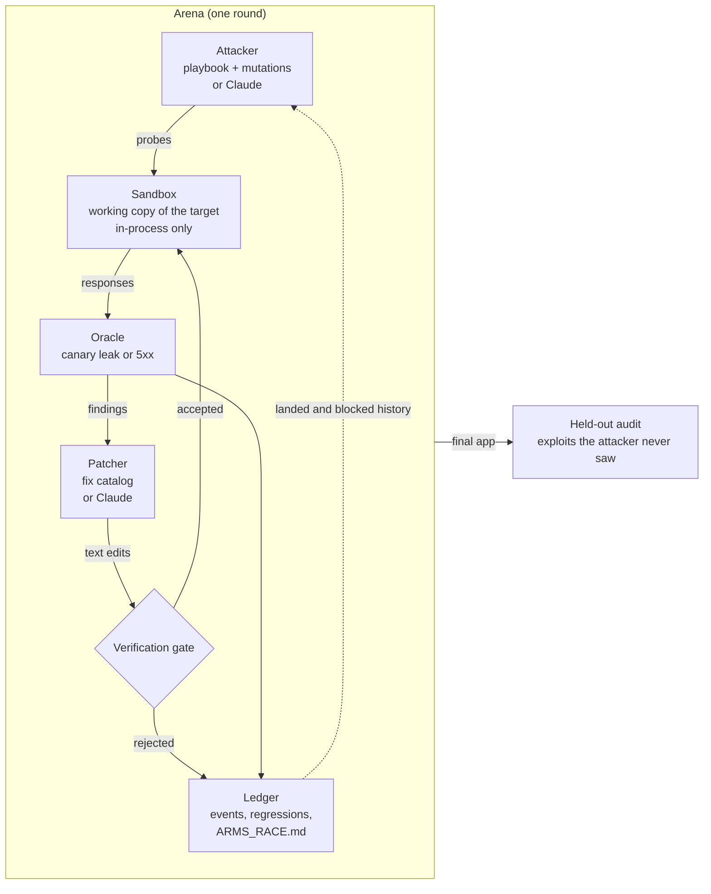

# codebase-red-team

[](https://github.com/AkshayTallikar/codebase-red-team/actions/workflows/ci.yml)

An attacker agent breaks a deliberately vulnerable web app. A patcher agent fixes it. Every fix has to survive the attacker's next round, which mutates exactly the payloads that were just blocked. Then a held-out audit checks whether the loop's own "hardened" verdict can be trusted.

**Result:** when the attacker only scans once, the loop declares rushed fixes "hardened" while held-out exploits still get in (3 of 11 on one app, 7 of 11 on the other). When the attacker adapts to what was blocked, it catches every rushed fix, and every final app passes the audit.

```
$ python -m redteam bench
notes adaptive naive-first: hardened, audit 0/11
notes adaptive correct-first: hardened, audit 0/11
notes one-shot naive-first: hardened, audit 3/11 (false confidence)
notes one-shot correct-first: hardened, audit 0/11
billing adaptive naive-first: hardened, audit 0/11
billing adaptive correct-first: hardened, audit 0/11
billing one-shot naive-first: hardened, audit 7/11 (false confidence)
billing one-shot correct-first: hardened, audit 0/11
```

## Why

Security review is usually one shot: a scanner runs, someone patches the findings, and nobody checks whether the patch closed the hole or just moved it. Real attackers adapt. Strip `../` from a filename and the next request sends `....//`. Block the key `role` and the next request sends `Role`.

This project treats hardening as an adversarial loop instead:

- the attacker learns from what got blocked, not just from what worked
- a patch is only accepted if it kills the exploit, keeps every earlier exploit dead, and leaves normal use working
- every exploit that ever landed becomes a permanent regression test
- an independent audit, with exploits the attacker never saw, grades the final app

## The benchmark

`redteam bench` attacks every target under four strategies and audits each final app. From the [recorded scorecard](examples/bench/SCORECARD.md):

| Target | Attacker | Patcher | Bypasses caught | Loop says | Audit | False confidence |
|---|---|---|---|---|---|---|
| notes | adaptive | naive-first | 2 | hardened | 0 of 11 landed | no |
| notes | adaptive | correct-first | 0 | hardened | 0 of 11 landed | no |
| notes | one-shot | naive-first | 0 | hardened | 3 of 11 landed | **yes** |
| notes | one-shot | correct-first | 0 | hardened | 0 of 11 landed | no |
| billing | adaptive | naive-first | 3 | hardened | 0 of 11 landed | no |
| billing | adaptive | correct-first | 0 | hardened | 0 of 11 landed | no |
| billing | one-shot | naive-first | 0 | hardened | 7 of 11 landed | **yes** |
| billing | one-shot | correct-first | 0 | hardened | 0 of 11 landed | no |

- **Adaptive** sends seed hypotheses, then mutates everything that landed and every mutation that was blocked. **One-shot** replays its seeds each round, like a scanner run after every fix.
- **Naive-first** ships the kind of rushed fix teams really merge (a keyword blocklist, a string strip), then the real fix if that one is bypassed. **Correct-first** goes straight to the real fix.
- **Audit** replays held-out exploits against the final app, each in a fresh copy. They are written apart from the playbook and never shown to the attacker.
- **False confidence** means the loop reported hardened while the audit still got in. Only the one-shot attacker paired with naive fixes produces it, and on both targets it does.

## Two targets

Both are small FastAPI services with seeded weaknesses. A target bundles its app, the requests a legitimate user must keep making, the attacker's first hypotheses, a fix catalog and its audit exploits, so adding a third is one directory.

| Target | Weakness | Rushed fix | Bypass the adaptive attacker found |
|---|---|---|---|
| notes | SQL injection in search | block `" OR "` | `' or 1=1 --` |
| notes | path traversal in file reads | strip `../` | `....//secrets.txt` |
| notes | missing ownership check, crash on `limit=0` | (real fix first) | |
| billing | mass assignment on `PATCH /me` | reject the key `role` | `{"Role": "admin"}` |
| billing | SSRF in invoice import | block the text `metadata.internal` | `http://METADATA.INTERNAL/...` |
| billing | trusted `X-Forwarded-User` header | ignore the value `admin` | `X-Forwarded-User: Admin` |
| billing | missing ownership check | (real fix first) | |

The recorded runs tell each story round by round: [notes](examples/notes-run/ARMS_RACE.md) and [billing](examples/billing-run/ARMS_RACE.md). Each run writes:

| File | What it holds |
|---|---|
| `ARMS_RACE.md` | scoreboard, independent audit and round-by-round story |
| `events.jsonl` | every probe, finding, bypass and patch decision |
| `regressions.json` | every probe that ever landed, by weakness |
| `final_app.py` | the hardened source |
| `summary.json` | stop reason, patch counts, open weaknesses and the audit |

## How it works



1. **Attacker** plans a batch of probes from the app's route list and the attack history. The offline `PlaybookAttacker` starts with the target's hypotheses, then mutates every exploit that landed and every mutation that was blocked (keyword case, quote styles, nested traversal, encoded separators, boundary integers, neighbouring ids, JSON key spellings, URL host spellings, header value casing). The `LLMAttacker` asks Claude for probes, including headers and a JSON body, as schema-checked JSON.
2. **Sandbox** loads a per-run working copy of the target behind a test client and sends each probe. For targets where an exploit changes state (promoting yourself to admin), the app is rebuilt before every probe so one landing cannot make later probes look like exploits.
3. **Oracle** has two rules. A response that contains the run's random canary is a leak; any 5xx is a crash. That one leak rule covers SQL injection, broken access control and path traversal.
4. **Patcher** proposes exact `{old, new}` text edits for each finding. The offline `ReferencePatcher` replays a fix catalog; the `LLMPatcher` asks Claude and only ever sees redacted evidence.
5. **Verification gate** applies the edits to a fresh copy and accepts them only if all of these hold:
   - the patched app loads
   - the exploit no longer lands
   - every earlier regression for a closed weakness stays blocked
   - the legitimate user can still do everything the target lists, for example alice can still list, search, read and create her notes, and admin settings stay forbidden to her on billing

   Deleting the endpoint fails the last check, so it is not a fix.
6. **Arena** repeats until a round finds nothing, the attacker runs out of ideas, or the round limit is hit. A weakness that lands again after an accepted patch is logged as a bypass and reopened.
7. **Audit** replays the target's held-out exploits against the final app and reports what still gets in.

More detail is in [docs/design.md](docs/design.md).

## Safety boundary

The attacker only ever attacks the bundled sample app, and only inside the Python process:

- The sandbox serves the target through an in-process test client. No sockets are opened and nothing is sent over a network.
- The billing app's SSRF fetches through an in-memory fake web: a dictionary and a tiny resolver. A test checks that the app imports no network client.
- A probe can only be a method, a path starting with `/`, query params, headers and a JSON body. Absolute URLs, `//host` paths and `Host` headers are rejected before anything is sent.
- The only secret in play is a random canary generated per run, and it is redacted from every log and report.
- The seed source is never edited. Patches go to a per-run copy.

The apps under `src/redteam/targets/` are vulnerable on purpose. Don't deploy them.

## Run it

Requires Python 3.11 or newer.

```bash
git clone https://github.com/AkshayTallikar/codebase-red-team
cd codebase-red-team
python -m venv .venv && source .venv/bin/activate
pip install -e ".[dev]"

python -m redteam run --target notes --out runs/notes     # offline, deterministic, no API key
python -m redteam run --target billing --out runs/billing
python -m redteam bench --out runs/bench                   # all targets, four strategies, SCORECARD.md
pytest
```

To put Claude on both sides of the fight:

```bash
pip install -e ".[anthropic]"
export ANTHROPIC_API_KEY=...
python -m redteam run --backend anthropic --target billing --out runs/claude
python -m redteam run --backend anthropic --model claude-sonnet-5-5   # a larger model
```

With `--backend anthropic` the attacker and patcher call the model with structured outputs, so every response is JSON that matches the agent's schema before it is validated again. If the model declines a request, the attacker falls back to the offline playbook. Options: `--rounds` (default 6) and `--budget` (probes per round, default 40).

## Project layout

```
src/redteam/
  targets/base.py            the Target value: app, checks, seeds, fixes, audit
  targets/notes/             notes service: SQL injection, IDOR, traversal, crash
  targets/billing/           invoicing service: mass assignment, SSRF, header trust, IDOR
  sandbox.py                 in-process loader and the path-only probe boundary
  oracle.py                  canary leak and crash detection, evidence redaction
  agents/attacker.py         PlaybookAttacker, mutation engine, LLMAttacker
  agents/patcher.py          ReferencePatcher fix catalog, LLMPatcher
  patching.py                exact-match text edits
  gate.py                    verification gate and functional checks
  arena.py                   the round loop and the ARMS_RACE.md report
  audit.py                   held-out exploit replay
  bench.py                   strategy matrix and SCORECARD.md
  ledger.py                  append-only event log
  llm/                       LLMBackend protocol, Claude backend, offline fake
  cli.py                     redteam run and redteam bench
examples/                    recorded runs for both targets and the benchmark
tests/                       unit tests, full offline runs, and replays of the recordings
```

## How this repo was built

The repo was built the way it describes: by agents, through an ordinary software lifecycle. A planning agent wrote the [design doc](docs/design.md), split the work into milestones ([one](https://github.com/AkshayTallikar/codebase-red-team/milestone/1), [two](https://github.com/AkshayTallikar/codebase-red-team/milestone/2)) of issues, and wrote an interface spec for each one. Smaller coding agents implemented each issue on its own branch. The planner reviewed the code, corrected what the specs got wrong (one held-out exploit, for instance, only works against the naively patched app, so the audit test checks "breaks the seed or the naive fix"), opened one pull request per issue, and merged each one only after CI passed on Python 3.11, 3.12 and 3.13. CI needs no API key, because every LLM path is tested against an offline fake.

## Next

- Run the benchmark with Claude on both sides and compare it with the offline playbook
- White-box mode where the attacker reads the source as well as the routes
- Multi-step attack chains (sign in, escalate, then read)
- Run several attacker strategies as a population and keep the ones that land
