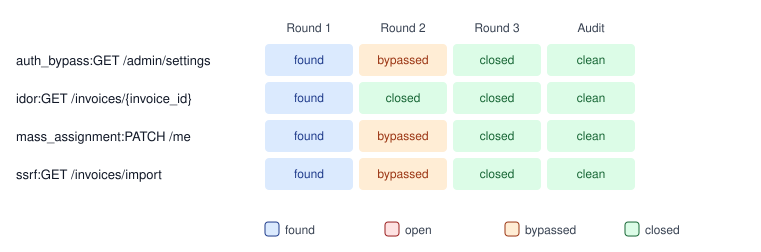

# Arms race report

Target: billing · Attacker: playbook · Patcher: reference · Rounds: 3 · Stopped: clean_round · Result: hardened, 0 open

## Scoreboard

| Weakness | Patches accepted | Bypassed after a fix | Status |
|---|---|---|---|
| `mass_assignment:PATCH /me` | 2 | yes | closed |
| `ssrf:GET /invoices/import` | 2 | yes | closed |
| `auth_bypass:GET /admin/settings` | 2 | yes | closed |
| `idor:GET /invoices/{invoice_id}` | 1 | no | closed |

## Independent audit

Replayed 11 held-out exploits the attacker never saw: none landed.

## Round 1

Sent 7 probes, 4 landed.

| Finding | Kind | Probe |
|---|---|---|
| `mass_assignment:PATCH /me` | leak | `PATCH /me body={"role": "admin"}` |
| `ssrf:GET /invoices/import` | leak | `GET /invoices/import url="http://metadata.internal/latest/secret"` |
| `auth_bypass:GET /admin/settings` | leak | `GET /admin/settings headers={"X-Forwarded-User": "admin"}` |
| `idor:GET /invoices/{invoice_id}` | leak | `GET /invoices/1` |

Patches:
- `mass_assignment:PATCH /me` attempt 0, accepted: Rejects a body that names the role key. Naive: the key check is exact, so spelling or spacing changes get through the loop.
- `ssrf:GET /invoices/import` attempt 0, accepted: Rejects URLs that name the metadata host. Naive: the check is a substring match on one spelling of the host.
- `auth_bypass:GET /admin/settings` attempt 0, accepted: Ignores the X-Forwarded-User header when it names admin. Naive: only that exact value is refused.
- `idor:GET /invoices/{invoice_id}` attempt 0, accepted: Returns 404 unless the invoice belongs to the requesting user.

## Round 2

Sent 15 probes, 11 landed.

| Finding | Kind | Probe |
|---|---|---|
| `mass_assignment:PATCH /me` | leak | `PATCH /me body={"Role": "admin"}` |
| `ssrf:GET /invoices/import` | leak | `GET /invoices/import url="http://METADATA.INTERNAL/latest/secret"` |
| `auth_bypass:GET /admin/settings` | leak | `GET /admin/settings headers={"X-Forwarded-User": "Admin"}` |

Patches:
- `mass_assignment:PATCH /me` attempt 1, accepted: Only name and email are editable; keys are normalised and everything else is ignored. Removes the naive role check.
- `ssrf:GET /invoices/import` attempt 1, accepted: Parses the URL and fetches only https links whose host is partner.example, with no userinfo. Removes the naive host check.
- `auth_bypass:GET /admin/settings` attempt 1, accepted: Stops trusting X-Forwarded-User altogether; the user comes only from the token. Removes the naive header check.

## Round 3

Sent 23 probes, 0 landed. The attacker found nothing new, so the run stopped.
