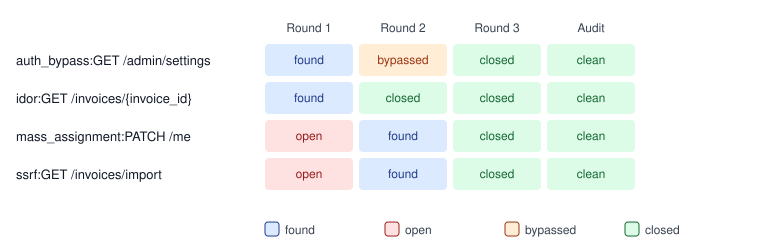

# Arms race report

Target: billing · Attacker: white-box · Patcher: reference · Rounds: 3 · Stopped: clean_round · Result: hardened, 0 open

## Scoreboard

| Weakness | Patches accepted | Bypassed after a fix | Status |
|---|---|---|---|
| `auth_bypass:GET /admin/settings` | 2 | yes | closed |
| `ssrf:GET /invoices/import` | 1 | no | closed |
| `idor:GET /invoices/{invoice_id}` | 1 | no | closed |
| `mass_assignment:PATCH /me` | 1 | no | closed |

## Independent audit

Replayed 11 held-out exploits the attacker never saw: none landed.

## Round 1

Sent 14 probes, 10 landed.

| Finding | Kind | Probe |
|---|---|---|
| `auth_bypass:GET /admin/settings` | leak | `GET /admin/settings headers={"X-Forwarded-User": "admin"}` |
| `ssrf:GET /invoices/import` | leak | `GET /invoices/import url="http://127.0.0.1/latest/secret"` |
| `idor:GET /invoices/{invoice_id}` | leak | `GET /invoices/1` |
| `mass_assignment:PATCH /me` | leak | `PATCH /me body={"role": "admin"}` |

Patches:
- `auth_bypass:GET /admin/settings` attempt 0, accepted: Ignores the X-Forwarded-User header when it names admin. Naive: only that exact value is refused.
- `ssrf:GET /invoices/import` attempt 0, rejected: exploit still works; regression reopened: GET /invoices/import {'url': 'http://127.0.0.1/latest/secret'}; regression reopened: GET /invoices/import {'url': 'http://169.254.169.254/latest/secret'}; regression reopened: GET /invoices/import {'url': 'http://localhost/latest/secret'}; regression reopened: GET /invoices/import {'url': 'http://localhost/'}
- `idor:GET /invoices/{invoice_id}` attempt 0, accepted: Returns 404 unless the invoice belongs to the requesting user.
- `mass_assignment:PATCH /me` attempt 0, rejected: regression reopened: PATCH /me {} body={"Role": "admin"}; regression reopened: PATCH /me {} body={"ROLE": "admin"}

## Round 2

Sent 30 probes, 20 landed.

| Finding | Kind | Probe |
|---|---|---|
| `auth_bypass:GET /admin/settings` | leak | `GET /admin/settings headers={"X-Forwarded-User": "Admin"}` |
| `ssrf:GET /invoices/import` | leak | `GET /invoices/import url="http://127.0.0.1./latest/secret"` |
| `mass_assignment:PATCH /me` | leak | `PATCH /me body={" role": "admin"}` |

Patches:
- `auth_bypass:GET /admin/settings` attempt 1, accepted: Stops trusting X-Forwarded-User altogether; the user comes only from the token. Removes the naive header check.
- `ssrf:GET /invoices/import` attempt 1, accepted: Parses the URL and fetches only https links whose host is partner.example, with no userinfo. Removes the naive host check.
- `mass_assignment:PATCH /me` attempt 1, accepted: Only name and email are editable; keys are normalised and everything else is ignored. Removes the naive role check.

## Round 3

Sent 33 probes, 0 landed. The attacker found nothing new, so the run stopped.
