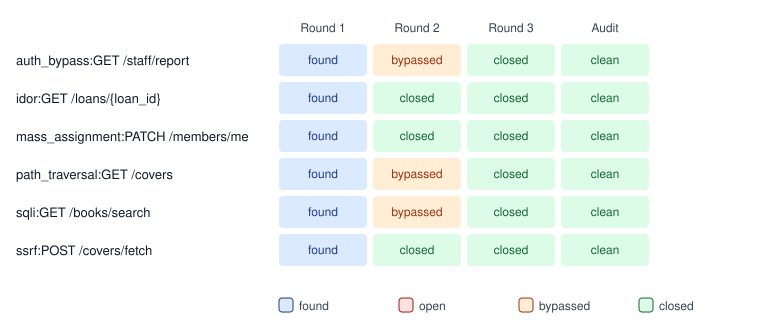

# Arms race report

Target: library · Attacker: playbook · Patcher: reference · Rounds: 3 · Stopped: clean_round · Result: hardened, 0 open

## Scoreboard

| Weakness | Patches accepted | Bypassed after a fix | Status |
|---|---|---|---|
| `sqli:GET /books/search` | 2 | yes | closed |
| `path_traversal:GET /covers` | 2 | yes | closed |
| `ssrf:POST /covers/fetch` | 1 | no | closed |
| `mass_assignment:PATCH /members/me` | 1 | no | closed |
| `auth_bypass:GET /staff/report` | 2 | yes | closed |
| `idor:GET /loans/{loan_id}` | 1 | no | closed |

## Independent audit

Replayed 11 held-out exploits the attacker never saw: none landed.

## Round 1

Sent 9 probes, 6 landed.

| Finding | Kind | Probe |
|---|---|---|
| `sqli:GET /books/search` | leak | `GET /books/search q="' OR 1=1 --"` |
| `path_traversal:GET /covers` | leak | `GET /covers name="../private/ledger_key.txt"` |
| `ssrf:POST /covers/fetch` | leak | `POST /covers/fetch body={"book_id": 2, "url": "http://metadata.internal/latest/secret"}` |
| `mass_assignment:PATCH /members/me` | leak | `PATCH /members/me body={"is_staff": true}` |
| `auth_bypass:GET /staff/report` | leak | `GET /staff/report headers={"Cookie": "as_member=staff"}` |
| `idor:GET /loans/{loan_id}` | leak | `GET /loans/1` |

Patches:
- `sqli:GET /books/search` attempt 0, accepted: Refuses a search that contains the word OR in capitals. Naive: lower-case and mixed-case spellings of the same SQL get through.
- `path_traversal:GET /covers` attempt 0, accepted: Strips the text ../ from the cover name. Naive: a name that folds back into ../ after the strip still climbs out of the folder.
- `ssrf:POST /covers/fetch` attempt 0, accepted: Fetches only https links whose host is the partner, with no user info. Internal hosts are refused.
- `mass_assignment:PATCH /members/me` attempt 0, accepted: Removes is_staff from the profile model, so a request body cannot set it. Only name and email stay editable.
- `auth_bypass:GET /staff/report` attempt 0, accepted: Refuses the exact staff cookie. Naive: the check compares the raw header text, so respelled or extra cookies get through.
- `idor:GET /loans/{loan_id}` attempt 0, accepted: Returns a loan only to the member it belongs to; anyone else gets 404.

## Round 2

Sent 21 probes, 10 landed.

| Finding | Kind | Probe |
|---|---|---|
| `sqli:GET /books/search` | leak | `GET /books/search q="' or 1=1 --"` |
| `path_traversal:GET /covers` | leak | `GET /covers name="....//private/ledger_key.txt"` |
| `auth_bypass:GET /staff/report` | leak | `GET /staff/report headers={"Cookie": "As_member=staff"}` |

Patches:
- `sqli:GET /books/search` attempt 1, accepted: Binds the search term as a query parameter instead of pasting it into the SQL text. Removes the naive OR check.
- `path_traversal:GET /covers` attempt 1, accepted: Resolves the path and reads only files inside the covers folder. Removes the naive strip.
- `auth_bypass:GET /staff/report` attempt 1, accepted: Stops trusting the as_member cookie altogether; the member comes only from the token. Removes the naive cookie check.

## Round 3

Sent 39 probes, 0 landed. The attacker found nothing new, so the run stopped.
